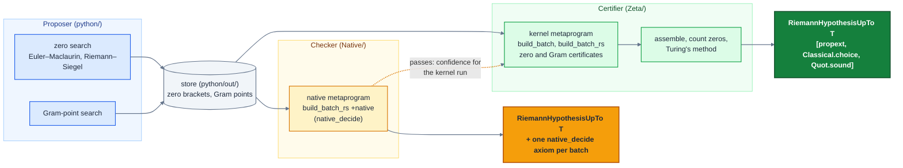

# Kernel-checking the nontrivial zeros of the Riemann zeta function

This repository proves in Lean 4 that all the nontrivial zeros of the Riemann 
zeta function up to a specified height $T$ lie on the critical line, 
as predicted by the Riemann Hypothesis. It moreover proves the location of 
the nontrivial zeros on the critical line and provides the ability to refine 
the precision of the zero locations. So far this has been carried out in the 
kernel up to height $T = 100{,}013$ on a laptop and $T = 1{,}000{,}449$ on a 
server, and with native checking up to $T = 10{,}001{,}072$ on a laptop 
(see [Frontier](#frontier)).

---

## Table of contents

- [Main theorem](#main-theorem)
- [Frontier](#frontier)
- [Architecture](#architecture)
- [Trust model](#trust-model)
- [Scaling](#scaling)
- [Lean libraries](#lean-libraries)
- [Installation](#installation)
- [Build](#build)
- [Comparator](#comparator)
- [Authors, license and citation](#authors-license-and-citation)

---

## Main theorem 

The main theorem is a term of type
```lean
def RiemannHypothesisUpTo (T : ℝ) : Prop :=
  ∀ s, riemannZeta s = 0 → (¬∃ n : ℕ, s = -2 * (n + 1)) → s ≠ 1 → |s.im| < T → s.re = 1/2
```
which is the statement that all the nontrivial zeros of the Riemann zeta 
function with imaginary part in `(-T, T)` (equivalently `(0, T)`) lie 
on the critical line. It is proved as `Zeta.riemannHypothesisUpTo_<T>`, and as
`Native.riemannHypothesisUpTo_<T>` at the native trust layer (see [Trust model](#trust-model)).

Different values of `T` are provided in different branches.

| Branch | $T$ | Kernel | Native |
|---|---:|---|---|
| `main` | 10,011 | `Zeta.riemannHypothesisUpTo_10011` | `Native.riemannHypothesisUpTo_10011` |
| `1e5` | 100,013 | `Zeta.riemannHypothesisUpTo_100013` | `Native.riemannHypothesisUpTo_100013` |
| `1e6` | 1,000,449 | `Zeta.riemannHypothesisUpTo_1000449` | `Native.riemannHypothesisUpTo_1000449` |
| `1e7` | 10,001,072 | — | `Native.riemannHypothesisUpTo_10001072` |

--- 

## Frontier

Heights reached at each trust layer; see [Architecture](#architecture) for the proposer,
native checker and kernel, and [Trust model](#trust-model) for what each one trusts.

| Trust layer<sup>[1](#note-trust)</sup> | Height $T$ | Zeros | Hardware | Wall time<sup>[5](#note-wall)</sup> | CPU core-hours<sup>[6](#note-cpu)</sup> | CPU-ms / zero |
|---|---:|---:|---|---:|---:|---:|
| **Kernel** | 10,011 | 10,156 | laptop<sup>[2](#note-laptop)</sup> | 1 min 26 s | 0.16 | 56 |
| | 100,013 | 138,090 | laptop | 32 min | 3.7 | 97 |
| | 1,000,449 | 1,748,002 | server<sup>[3](#note-server)</sup> | 3 h 28 min | 165 | 340 |
| | 10,001,072 | 21,138,563 | server |  | ≈ 5,400<sup>[7](#note-projected)</sup> | ≈ 920 |
| | 100,000,300 | 248,008,818 | HPC node<sup>[4](#note-hpc)</sup> | | | |
| **Native** | 10,011 | 10,156 | laptop | 43 s | 0.021 | 7.4 |
| | 100,013 | 138,090 | laptop | 1 min 18 s | 0.12 | 3.1 |
| | 1,000,449 | 1,748,002 | laptop | 15 min | 1.9 | 3.9 |
| | 10,001,072 | 21,138,563 | laptop | 5 h 20 min | 46.7 | 8.0 |
| | 100,000,300 | 248,008,818 | server | 85 h 20 min | 4,018 | 58 |
| **Python** | 10,011 | 10,156 | laptop | 16 s | 0.025 | 8.7 |
| | 100,013 | 138,090 | laptop | 1 min 18 s | 0.18 | 4.8 |
| | 1,000,449 | 1,748,002 | laptop | 17 min | 2.5 | 5.2 |
| | 10,001,072 | 21,138,563 | laptop | 5 h 48 min | 53 | 9.0 |
| | 100,000,300 | 248,008,818 | server | 40 h 28 min | 1,927 | 28 |

1. <a id="note-trust"></a>**Trust layers** are as in [Trust model](#trust-model).
2. <a id="note-laptop"></a>**Laptop.** A MacBook Pro with an Apple M4 (10 cores: 4 performance,
   6 efficiency) and 16 GB of memory.
3. <a id="note-server"></a>**Server.** A dedicated server with 24 cores, 48 threads and 256GB RAM.
4. <a id="note-hpc"></a>**HPC node.** TODO.
5. <a id="note-wall"></a>**Wall time** represents the time it took to build the certificate modules 
   only, with Mathlib and the rest of the libraries built beforehand. Uses all available threads, or as 
   many workers as `build.sh` fits in memory. 
6. <a id="note-cpu"></a>**CPU core-hours** represents the user and system CPU time for the 
   certificate modules only, with Mathlib and the rest of the libraries built beforehand. 
   CPU-ms/zero divides by the number of zeros.
7. <a id="note-projected"></a>**Projected** by extrapolating the cost per zero
   from the measured runs as a fixed cost plus a term proportional to $\nu = \sqrt{T/2\pi}$,
   the length of the Riemann–Siegel main sum.

---

## Architecture 

The architecture of the project code is based on a proposer-certifier model.
The proposer is a Python library, within the `python` subdirectory, which 
contains code that searches for zeros on the critical line and Gram points
needed to apply Turing's method for Riemann hypothesis verification.
It then stores this as data to communicate with the certifier.
Further details on the Python code can be found in [`python/README.md`](python/README.md).

The certifier is a Lean metaprogram which reads in the stored data and builds 
proofs that the data are correct proposals. 
For example, in the case of zeta zeros, the metaprogram will read in a row of 
data (which typically consists of a lower and upper bound of the imaginary 
part of the zero, plus algorithm parameters), and it will generate a proof
of its _zero certificate_. In the case of the Riemann-Siegel search algorithm,
this certificate has the following form:
```lean
structure ZIntervalRS.Certificate (I : ZIntervalRS) where
  le_fst : 32 * Real.pi ≤ I.fst
  is_sign_change : I.fstVal * I.sndVal < 0
  fst_error : ‖I.fstVal‖ > hardyZErrorBoundRS I.fst
  snd_error : ‖I.sndVal‖ > hardyZErrorBoundRS I.snd
```
The metaprogram must prove that `t` is large enough to apply Riemann-Siegel 
(`le_fst`), that the approximant exhibits a sign change at the endpoints 
(`is_sign_change`), and that the left/right endpoint approximate values 
are greater in absolute value than the error bound (`fst_error`/`snd_error`) 
so that this also represents a sign change of the true `Z`-function.
There are similar certificates for proving that an interval contains a
Gram point. All of these proofs are assembled, the zeros are counted 
and Turing's method is applied to prove that the Riemann hypothesis holds 
up to some height $T$. This is proved fully in the kernel, depending 
only on the standard axiom set `[propext, Classical.choice, Quot.sound]`.

Because the kernel proof is computationally expensive, this architecture 
becomes a proposer-checker-certifier model in high-compute scenarios 
(for example, beyond `T = 1e6`).
The proposer runs as usual; however prior to the kernel build we run a 
native sibling of the kernel metaprogram within `Native`. 
This allows `native_decide`, thus making the metaprogram significantly faster 
at the cost of trusting the compiler and expanding the axiom set.
If this succeeds, then we have higher confidence in a multi-CPU-day run on the 
kernel.

In cases where high compute is not available, proposer-checker represents 
a performant but lower-trust architecture.



--- 

## Trust model

Each layer of the [architecture](#architecture) corresponds to a different 
degree of trust.

| Layer | Output | Trusted components |
|---|---|---|
| **Python** (`python/`) | numerical evidence (zero intervals and Gram blocks) | none |
| **Kernel** (`Zeta/`) | `Zeta.riemannHypothesisUpTo_<T>` | the Lean kernel and the axioms `propext`, `Classical.choice`, `Quot.sound` |
| **Native** (`Native/`) | `Native.riemannHypothesisUpTo_<T>` | the above, plus the Lean compiler and runtime (one `native_decide` axiom per batch) |

- The Proposer is untrusted. It tracks analytic truncation bounds throughout, but not
  floating-point roundoff, and serves only as a provider of numerical evidence.
  The Lean metaprogram itself is similarly untrusted, as it only proposes proofs.
- The native checker is proved sound in Lean. Additional trust is required that its compiled
  code runs correctly. It is used only for the Riemann-Siegel batches, which make up the vast
  majority of batches; the small number of Euler-Maclaurin and Gram point certificates are always
  kernel-checked.

--- 

## Scaling

Scaling the project to work for large heights presented a number of 
computational challenges. Large heights means a large number of zeros.
A certificate for each zero must be proved.
Up to height 1,000,449 there are 1,748,002 zeros and so, not only is it 
difficult to optimise the kernel code to make this feasible, but simply
organising where these proofs should live and how they should be processed 
becomes a major challenge. 

### Kernel 

The kernel side is feasible because the metaprogram reduces every 
inequality to concrete numerals, so the kernel only ever compares
natural-number literals (`Nat.ble`, checked with GMP) rather than running 
`decide`, `norm_num` or `simp`. Further, the metaprogram is optimised to 
make these checks fewer and smaller, for example by proving shared terms 
(`log n`, `1/√n`, `π`) once per module and citing them. 

### Batching 

Zeros are collected into batches and the metaprogram proves certificates for 
all zeros in a batch.
Batch size is chosen to keep worker RAM at or under around 3.35GB, which is the 
available RAM per worker on the HPC node described above.
Up to height about 2e6 batch sizes of 200 are used, which were found empirically 
to optimise build time.
In general, the rule $\min(200, \lfloor 2.75 / (2.4 \cdot 10^{-5} \nu) \rfloor)$, where 
$\nu = \lfloor \sqrt{t / 2\pi} \rfloor$, is used to define batch sizes which result in smaller 
batch sizes as the height increases.
The rule comes from an empirical measurement showing the memory grows by around 
$2.4 \cdot 10^{-5}GB$ per row per unit of $\nu$, combined with a measurement of $0.6$GB fixed 
overhead for each worker.
These figures can be configured through global constants in `python/src/config.py` to suit 
different machine specs.
Subdirectories with potentially millions of files are avoided by grouping batches 
into subdirectories of 10,000 batch files.

The _public_ interface of each batch module is `BatchSpec`, which is just the 
existential statement that there is a list of certified zeros in a given range. 
Everything else is private.
Batch specs are assembled through a tree of groups: each level-`1` group 
assembles at most `125` batches, each level-`i + 1` group at most `125` 
level-`i` groups, and levels are added until at most `125` groups remain 
for the final assembler.
This avoids a single Lean module spanning millions of lines of code.


```
                                    Zeta.Main
                             riemannHypothesisUpTo_T
                                        ▲
                                    assembler
                       one BatchSpec for all zeros below T
                                        ▲
                ┌───────────────────────┼───────────────────────┐
         level-L group 1         level-L group 2    …    level-L group m
                ▲                                           (m ≤ 125)
                ⋮
                ▲
         level-2 group 1
      level-1 groups 1–125
                ▲
          ┌─────┴───────────────┬─────────────────────────┐
   level-1 group 1       level-1 group 2     …    level-1 group 125
    batches 1–125        batches 126–250        batches 15,501–15,625
          ▲
     ┌────┴─────────┬─────────────────┐
  batch 1        batch 2     …    batch 125
zeros 1–52    zeros 53–252   zeros 24,653–24,852
```

### Storage 

A single proof term for Riemann-Siegel certificates grows with the height $t$ 
(on the order of $\sqrt{t}$). These are kept in the private `olean` files for 
each batch. Around height $10^6$ these take up terabytes of storage, which makes 
even server runs a problem. To resolve this, we include compression and 
discarding options in the build script. Once built, the private oleans are 
no longer required by downstream modules, so they can be compressed on the fly
without affecting the final build. Compression reduces storage by around 4× 
and is lossless so enables easy restoration; discarding involves overwriting 
the private oleans with a placeholder, which effectively reduces their storage 
to zero but they can only be restored by rebuilding.

### Parallelisation

When running a full build on the kernel, the provided build script `./build.sh` 
will adaptively select the optimal number of workers for each range of heights. 
At large heights, a batch takes more memory to build, which can reduce the 
total number of available workers.
The script computes the height at which the maximum number of workers is 
no longer possible, then reduces workers successively by one as needed.
This can be overridden by setting `LEAN_NUM_THREADS` as usual.
The script also provides an `--estimate` flag which will test two batches 
and provide an estimate for the resultant build time; it will not perform
the full build with this flag.

### Native prechecking and precision

The native module can be used as a test prior to a more expensive kernel run 
at a given height. Running `./build.sh --native` will perform this.
This is particularly useful for catching failing zero checks that occur due to 
precision selection.
Precision selection is adaptive in the kernel metaprogram, meaning that if 
there is a failure then precision is raised (100-fold each time) until 
the check passes or it has been raised 3 times (by default).
Running the native module will alert you to whether the kernel will fail at the 
cap value supplied via `--retries` (default `3`); this is a prediction via a model of the kernel's enclosure widths.
This can then be set via CLI in the full build using the `--retries` flag, 
e.g. `./build.sh --retries 5`.

--- 

## Lean libraries

- `Zeta` consists of the formalized theory required to apply Turing's method and 
  certify approximant values. 
  - Complex analysis (argument principle, Hadamard factorisation, Euler-Maclaurin).
  - Analytic number theory (Riemann-von Mangoldt formula).
  - Riemann-Siegel approximation of Hardy's `Z`-function.
  - Certificates for zero and Gram point intervals.
  - The main theorem.
- `Enclosure` contains kernel-checked interval and ball arithmetic, with binary-splitting bounds on
  elementary functions (`exp`, `log`, `sin`, `cos`, `arctan`, `π`, `√`) exposed as tactics.
- `Bernoulli` develops Bernoulli and tangent numbers for the Euler–Maclaurin correction terms, and a
  Kummer regular-prime sweep. 
- `Native` is the native checker for the Riemann–Siegel certificates. Its checking functions
  (`Native.Eval`, built separately as `NativeEval` without Mathlib) are compiled to machine code,
  proved sound in Lean, and run through `native_decide`.
- [`PrimeNumberTheoremAnd`](https://github.com/AlexKontorovich/PrimeNumberTheoremAnd) (external,
  a pinned fork) is used for the following:
  - bounds on ζ;
  - residue calculus on rectangles;
  - Borel–Carathéodory and zero-counting results used by the analytic part of `Zeta`.

--- 

## Installation

Install Lean through [elan](https://github.com/leanprover/elan); the toolchain is pinned in
`lean-toolchain`. Next fetch the dependencies and Mathlib's prebuilt cache.
```bash
git clone https://github.com/smmercuri/zeta.git && cd zeta
lake exe cache get
```
The first build also compiles the `PrimeNumberTheoremAnd` dependency. The Python proposer is
only needed to regenerate the certificate data: see [`python/README.md`](python/README.md#installation).

---

## Build

```bash
./build.sh                     # the headline theorem Zeta.riemannHypothesisUpTo_<T>
./build.sh --native            # its native counterpart Native.riemannHypothesisUpTo_<T>
./build.sh --proofs=discard    # drop each batch's proof term once built
./build.sh --estimate          # build two sample batches, then project time, memory and disk
./build.sh --retries 5         # the kernel raises a failing row's precision up to 5 times (default 3)
```
`build.sh` wraps `lake build`: it sizes the number of parallel workers to the free memory
(override with `LEAN_NUM_THREADS`) and warns when the proof terms would fill the disk (see
[Scaling](#scaling)). Building
`Zeta.Main` prints the headline theorem's axioms. To certify a different height, regenerate the
store and the certificates as described in [`python/README.md`](python/README.md#usage).

---

## Comparator

[`leanprover/comparator`](https://github.com/leanprover/comparator) checks independently that the
proof establishes exactly the statement in a separate challenge file, using only the standard
axioms, by re-checking the whole dependency tree in a fresh kernel. `comparator/` sets this up both
globally (one challenge for the main theorem) and sharded (one challenge per batch, plus a
reduction), so large heights can be verified in parallel. See
[`comparator/README.md`](comparator/README.md).

---

## Authors, license and citation

Salvatore Mercuri and Bhavik Mehta. Released under the Apache License 2.0 (see [`LICENSE`](LICENSE)).

To cite this work:
```bibtex
@software{zeta,
  author = {Mercuri, Salvatore and Mehta, Bhavik},
  title  = {Kernel-checking the nontrivial zeros of the {R}iemann zeta function},
  year   = {2026},
  url    = {https://github.com/smmercuri/zeta}
}
```
