# Certifying the Riemann hypothesis up to bounded height in Lean

This repository proves in Lean's kernel that all the nontrivial zeros of the 
Riemann zeta function up to a specified height $T$ lie on the critical line, 
as predicted by the Riemann hypothesis. 
Intervals are certified on the critical line, proving the location of 
nontrivial zeros with configurable precision. 
The main theorem is proved fully in the kernel, depending 
only on the standard axiom set `[propext, Classical.choice, Quot.sound]`.
The kernel is asked only to check: both the zero search and the numerical 
evaluation inside the proofs are done outside it (see [Architecture](#architecture)).
Our current record is $T = 100,000,300$: the $248,008,818$ zeros with imaginary part between $0$ and
the Gram point $g \approx 100,000,300.797$ just above $T$ all lie on the critical line.


---

## Table of contents

- [Main theorem](#main-theorem)
- [Frontier](#frontier)
- [Installation](#installation)
- [Build](#build)
- [Comparator](#comparator)
- [Architecture](#architecture)
- [Trust model](#trust-model)
- [Scaling](#scaling)
- [Lean libraries](#lean-libraries)
- [Authors, license and citation](#authors-license-and-citation)

---

## Main theorem 

The main theorem is a term of type
```lean
def RiemannHypothesisUpTo (T : ℝ) : Prop :=
  ∀ s, riemannZeta s = 0 → (¬∃ n : ℕ, s = -2 * (n + 1)) → s ≠ 1 → |s.im| < T → s.re = 1/2
```
which is the statement that all the nontrivial zeros of the Riemann zeta 
function with imaginary part in `(-T, T)` (equivalently `(0, T)`) lie 
on the critical line. It is proved as `Zeta.riemannHypothesisUpTo_<T>`, and as
`Native.riemannHypothesisUpTo_<T>` at the Native trust layer (see [Trust model](#trust-model)).

--- 

## Frontier

Heights reached at each trust layer; see [Architecture](#architecture) for the role that Kernel, Native, and Python play, and [Trust model](#trust-model) for what each one trusts.

| Trust layer | Height $T$ | Zeros<sup>[1](#note-zeros)</sup> | Hardware | Wall time<sup>[2](#note-wall)</sup> | CPU core-hours<sup>[3](#note-cpu)</sup> | CPU-ms / zero |
|---|---:|---:|---|---:|---:|---:|
| **Kernel** | [10,011](https://github.com/smmercuri/zeta/tree/v1-1e4) | 10,156 | laptop<sup>[4](#note-laptop)</sup> | 1 min 29 s | 0.13 | 46 |
| | [100,013](https://github.com/smmercuri/zeta/tree/v1-1e5) | 138,090 | laptop | 18 min 25 s | 2.5 | 65 |
| | [1,000,449](https://github.com/smmercuri/zeta/tree/v1-1e6) | 1,748,002 | server<sup>[5](#note-server)</sup> | 1 h 40 min | 79 | 164 |
| | [10,001,072](https://github.com/smmercuri/zeta/tree/v1-1e7) | 21,138,563 | server | 133 h 58 min<sup>[7](#note-previous)</sup> | 6,417 | 1,093 |
| | [100,000,300](https://github.com/smmercuri/zeta/tree/v1-1e8) | 248,008,818 | HPC<sup>[6](#note-hpc)</sup> | 49 h 55 min<sup>[7](#note-previous)</sup> | 244,190 | 3,545 |
| **Native** | [10,011](https://github.com/smmercuri/zeta/tree/v1-1e4) | 10,156 | laptop | 26 s | 0.012 | 4.3 |
| | [100,013](https://github.com/smmercuri/zeta/tree/v1-1e5) | 138,090 | laptop | 1 min 9 s | 0.11 | 2.9 |
| | [1,000,449](https://github.com/smmercuri/zeta/tree/v1-1e6) | 1,748,002 | laptop | 14 min | 1.9 | 3.9 |
| | [10,001,072](https://github.com/smmercuri/zeta/tree/v1-1e7) | 21,138,563 | laptop | 5 h 20 min<sup>[7](#note-previous)</sup> | 46.7 | 8.0 |
| | [100,000,300](https://github.com/smmercuri/zeta/tree/v1-1e8) | 248,008,818 | server | 85 h 20 min<sup>[7](#note-previous)</sup> | 4,018 | 58 |
| **Python** | [10,011](https://github.com/smmercuri/zeta/tree/v1-1e4) | 10,156 | laptop | 39 s | 0.027 | 9.7 |
| | [100,013](https://github.com/smmercuri/zeta/tree/v1-1e5) | 138,090 | laptop | 1 min 40 s | 0.19 | 4.9 |
| | [1,000,449](https://github.com/smmercuri/zeta/tree/v1-1e6) | 1,748,002 | laptop | 17 min | 2.6 | 5.3 |
| | [10,001,072](https://github.com/smmercuri/zeta/tree/v1-1e7) | 21,138,563 | laptop | 5 h 48 min<sup>[7](#note-previous)</sup> | 53 | 9.0 |
| | [100,000,300](https://github.com/smmercuri/zeta/tree/v1-1e8) | 248,008,818 | server | 40 h 28 min<sup>[7](#note-previous)</sup> | 1,927 | 28 |

1. <a id="note-zeros"></a>**Zeros.** The number of zeros certified on the critical line, namely those with positive imaginary part below the first Gram point above `T`. Since `T` is that Gram point rounded down, this can slightly exceed the number in `(0, T)`.
2. <a id="note-wall"></a>**Wall time** represents the time to build the certificates, with Mathlib 
   and the rest of the libraries built beforehand, using all available threads or as many workers as 
   `build.sh` fits in memory. At $10^8$, where the build was split across many nodes over several 
   campaigns, it is the total time with at least one node building. For Native, it is an endpoint
   build (`scripts/build.sh --native --endpoint`), which skips the prediction of the kernel run. For Python, it is the time for the zero search.
   Each height links to the tagged commit its timings were measured at.
3. <a id="note-cpu"></a>**CPU core-hours** represents the total user and system CPU time for the build described in 
   the [wall time note](#note-wall). 
   CPU-ms/zero divides by the number of zeros.
4. <a id="note-laptop"></a>**Laptop.** A MacBook Pro with an Apple M4 (10 cores: 4 performance,
   6 efficiency) and 16 GB of memory.
5. <a id="note-server"></a>**Server.** A dedicated server with 24 cores, 48 threads and 256 GB RAM.
6. <a id="note-hpc"></a>**HPC.** EPCC's [Cirrus](https://www.cirrus.ac.uk/) supercomputer, whose
   nodes each have 288 cores, 576 threads and 745 GB RAM. This project had a budget of 128
   concurrent nodes, of which up to 57 were used concurrently.
7. <a id="note-previous"></a>**Previous version.** All timings at $10^7$ and $10^8$ (kernel, native and
   Python) were measured with an earlier version of the project. They are not directly comparable 
   with the kernel timings at lower heights, which were measured with the current version and are 
   substantially faster (at $10^6$, 1 h 40 min against 3 h 28 min previously).

Each of the heights in the above table is available through branches, tags or GitHub 
releases on the remote repository. 

| $T$ | Branch | Tag | Release |
|---:|---|---|---|
| 10,011 | `main` | `v1-1e4` | — |
| 100,013 | `1e5` | `v1-1e5` | — |
| 1,000,449 | `1e6` | `v1-1e6` | [`1e6`](https://github.com/smmercuri/zeta/releases/tag/v1-1e6) |
| 1,895,609 | `1.8956e6` | `v1-1.8956e6` | [`1.8956e6`](https://github.com/smmercuri/zeta/releases/tag/v1-1.8956e6) |
| 10,001,072 | — | `v1-1e7` | [`1e7`](https://github.com/smmercuri/zeta/releases/tag/v1-1e7) |
| 100,000,300 | — | `v1-1e8` | [`1e8`](https://github.com/smmercuri/zeta/releases/tag/v1-1e8) |

The branches provide complete repositories which can be rebuilt as they are.
The larger heights $10^7$ and $10^8$ are released using a GitHub tag, which is the commit 
these results correspond to, without the zero data or generated Lean certificates due to 
GitHub storage limitations.
At these tags, `Zeta/Main.lean` therefore still states the $10^4$ theorem and certificates.
To obtain the main theorem at the tag's height, download the zeros from Zenodo
([1e7](https://zenodo.org/records/24090490) and [1e8](https://zenodo.org/records/24085183), which also hold the
build logs and archives), unpack them into the repository, and run `./gen_certificates.sh` (in the repository root
at these tags). Each Zenodo record's README gives the exact commands.
Their comparator targets are also on Zenodo, with instructions in each record's `COMPARATOR.md`. Use those
rather than the targets committed at these two tags, which are for $10^4$, and avoid `gen_certificates.sh --comparator`,
which is impractical at this scale.

---

## Installation

Install Lean through [elan](https://github.com/leanprover/elan); the toolchain is pinned in
`lean-toolchain`. Next fetch the dependencies and Mathlib's prebuilt cache.
```bash
git clone https://github.com/smmercuri/zeta.git && cd zeta
lake exe cache get
```
The first build also compiles the `PrimeNumberTheoremAnd` dependency. The Python proposer is
only needed to regenerate the certificate data: see [`python/README.md`](python/README.md#installation).

---

## Build

This assumes the zero stores and Lean certificate files are already generated, as they are on each
branch.

```bash
scripts/build.sh                     # the headline theorem Zeta.riemannHypothesisUpTo_<T>
scripts/build.sh --native            # its native counterpart Native.riemannHypothesisUpTo_<T>
scripts/build.sh --native --endpoint # faster than --native alone, skips kernel-run prechecks
scripts/build.sh --proofs=archive    # losslessly compress each batch's proof term once built
scripts/build.sh --proofs=discard    # drop each batch's proof term once built
scripts/build.sh --proofs=auto       # keep proof terms if they fit easily, else archive, else discard
scripts/build.sh --estimate          # build two sample batches, then project time, memory and disk
scripts/build.sh --retries 5         # the kernel raises a failing interval's precision up to 5 times (default 3)
```
`build.sh` wraps `lake build`: it sizes the number of parallel workers to the free memory
(override with `LEAN_NUM_THREADS`) and warns when the proof terms would fill the disk (see
[Scaling](#scaling)). `Zeta.Main` checks the headline theorem's axioms with `#guard_msgs`, so the
build fails if they change.

To try a new height, run the entire pipeline in the `zeta` conda environment:

```bash
scripts/pipeline.sh <T> --build
```

This finds the zeros, generates the Lean certificates and builds them, choosing how to store proof
terms to fit the disk. It takes all the parameters that `build.sh` takes as well as the Python 
scripts `store.py` for generating zeros. Leave out `--build` to stop once the certificates are generated. The
individual steps and the `zeta` environment are described in [`python/README.md`](python/README.md#usage).

To depend on a tagged release, point your `require` at its tag, and Lake will download its prebuilt
archive if the release has one. Your project must use the same Lean toolchain and Mathlib version
as that release, otherwise Lake will rebuild every certificate from source. Files that import the
certificates must also start with `module`, because the archive has placeholders in place of the
proof terms.

---

## Comparator

[`leanprover/comparator`](https://github.com/leanprover/comparator) checks independently that the
proof establishes exactly the statement in a separate challenge file, using only the standard
axioms, by re-checking the whole dependency tree in a fresh kernel. `comparator/` sets this up
sharded (one challenge per batch, plus a reduction), which is the main method, and globally (one
challenge for the main theorem). See [`comparator/README.md`](comparator/README.md).

To run it, build the tools at tag `v4.35.0` in `.comparator-tools/` (gitignored), using this
project's Lean version, from the repository root:
```bash
git clone --branch v4.35.0 https://github.com/leanprover/comparator.git .comparator-tools
cd .comparator-tools
echo 'leanprover/lean4:v4.35.0' > lean-toolchain
lake build lean4export comparator
```
The tools must match the Lean version of the checkout (`lean-toolchain`). The `v1-1e7` and `v1-1e8`
tags use Lean `v4.33.1`, so for them use tag `v4.33.0` and `leanprover/lean4:v4.33.1`.
Then verify the main theorem's statement in shards:
```bash
comparator/sharded_run.sh [--size 10] [--jobs 1]
```
This checks the reduction and every batch, and gives one verdict at the end. It does not check the
formal theorem `Zeta.riemannHypothesisUpTo_<T>` itself; see
[`comparator/README.md`](comparator/README.md#running) for what it establishes 
and the warning below for why this is the default comparator setup.

Comparator can also be run on a single target with `comparator/run.sh <config.json>`, on chosen
batches with `comparator/shard.sh RiemannSiegel/Batch0001 RiemannSiegel/Batch0002`, or on a
reproducible random sample with `comparator/sharded_run.sh --sample 300 --seed <public value>`.

> **Warning.** The global check (`comparator/run.sh --force`) of `Zeta.riemannHypothesisUpTo_<T>` is currently impractical beyond
> `1e4`. This is because our proofs contain many large dyadic literals 
> which are multiples of $2^{64}$ and Lean hashes `Nat` literals modulo $2^{64}$ ([lean4#15686](https://github.com/leanprover/lean4/issues/15686)).

---

## Architecture 

The core design principle is to keep as much of the computation outside the 
kernel as possible, since the kernel is slow. 
There are two components which work in a proposer-certifier architecture.
The proposer is a Python library which searches for zeta zeros and Gram points 
and stores them as data.
The certifier consists of a metaprogram which evaluates numerical quantities in 
compiled code and emits a proof certifying the numerical Python artifacts. 
The kernel only needs to check the side conditions within these proofs, 
which are comparisons of natural-number literals; the kernel is able to 
do this quickly with GMP arithmetic.
Further details on the Python code can be found in [`python/README.md`](python/README.md).

The following zero interval certificate for the Riemann-Siegel
approximation is an example of what the metaprogram proves:
```lean
structure ZIntervalRS.Certificate (I : ZIntervalRS) where
  le_fst : 32 * Real.pi ≤ I.fst
  is_sign_change : I.fstVal * I.sndVal < 0
  fst_error : ‖I.fstVal‖ > hardyZErrorBoundRS I.fst
  snd_error : ‖I.sndVal‖ > hardyZErrorBoundRS I.snd
```
The metaprogram must prove that `t` is large enough to apply Riemann-Siegel 
(`le_fst`), that the approximant exhibits a sign change at the endpoints 
(`is_sign_change`), and that the left/right endpoint approximate values 
are greater in absolute value than the error bound (`fst_error`/`snd_error`) 
so that this also represents a sign change of the true `Z`-function.
There are similar certificates for proving that an interval contains a
Gram point. All of these proofs are assembled, the zeros are counted 
and Turing's method is applied to prove that the Riemann hypothesis holds 
up to some height $T$. This is proved fully in the kernel, depending 
only on the standard axiom set `[propext, Classical.choice, Quot.sound]`.

Because the kernel proof is computationally expensive, this architecture 
becomes a proposer-checker-certifier model in high-compute scenarios 
(for example, beyond `T = 1e6`).
The proposer runs as usual; however prior to the kernel build we run a 
native sibling of the metaprogram within `Native`. 
This allows `native_decide`, thus making the metaprogram significantly faster 
at the cost of trusting the compiler and expanding the axiom set.
This run also flags cases where the current configuration will fail, for example 
if the number of decimal places in the store does not separate close zeros.
In this way, a multi-CPU-day kernel run can be preconfigured with higher confidence of success.


In cases where high compute is not available, proposer-checker represents 
a performant but lower-trust architecture.

```mermaid
flowchart LR
    subgraph P["Proposer"]
        S["zero search<br/>Euler–Maclaurin, Riemann–Siegel"]
        G["Gram-point search"]
    end
    D[("store<br/>zero brackets, Gram points")]
    subgraph C["Checker"]
        N["native metaprogram<br/>build_batch_rs +native<br/>(native_decide)"]
    end
    subgraph K["Certifier"]
        M["metaprogram (compiled)<br/>build_batch, build_batch_rs<br/>computes values, emits proof terms"]
        KC["kernel<br/>checks the proof terms:<br/>literal comparisons"]
        A["assemble, count zeros,<br/>Turing's method"]
    end
    S --> D
    G --> D
    D --> N
    D --> M
    N -. "informs<br/>the kernel run" .-> M
    M --> KC
    KC --> A
    A --> RH["RiemannHypothesisUpTo T<br/>[propext, Classical.choice, Quot.sound]"]
    N --> RHN["RiemannHypothesisUpTo T<br/>+ one native_decide axiom per batch"]

    classDef proposer fill:#dbeafe,stroke:#2563eb,stroke-width:1.5px,color:#1e293b
    classDef store fill:#f1f5f9,stroke:#64748b,stroke-width:1.5px,color:#1e293b
    classDef checker fill:#fef3c7,stroke:#d97706,stroke-width:1.5px,color:#1e293b
    classDef certifier fill:#dcfce7,stroke:#16a34a,stroke-width:1.5px,color:#1e293b
    classDef kernelResult fill:#15803d,stroke:#14532d,stroke-width:2px,color:#ffffff,font-weight:bold
    classDef nativeResult fill:#f59e0b,stroke:#b45309,stroke-width:2px,color:#1e293b,font-weight:bold
    class S,G proposer
    class D store
    class N checker
    class M,KC,A certifier
    class RH kernelResult
    class RHN nativeResult
    style P fill:#eff6ff,stroke:#93c5fd,color:#1e3a8a
    style C fill:#fffbeb,stroke:#fcd34d,color:#78350f
    style K fill:#f0fdf4,stroke:#86efac,color:#14532d
    linkStyle default stroke:#64748b,stroke-width:1.5px
    linkStyle 4 stroke:#d97706,stroke-width:2px
```



--- 

## Trust model

Each layer of the [architecture](#architecture) corresponds to a different 
degree of trust. 

| Layer | Output | Trusted components |
|---|---|---|
| **Python** (`python/`) | numerical evidence (zero intervals and Gram blocks) | none |
| **Kernel** (`Zeta/`) | `Zeta.riemannHypothesisUpTo_<T>` | the Lean kernel and the axioms `propext`, `Classical.choice`, `Quot.sound` |
| **Native** (`Native/`) | `Native.riemannHypothesisUpTo_<T>` | the above, plus the Lean compiler and runtime (one `native_decide` axiom per batch) |

- The Python proposer is untrusted. It tracks analytic truncation bounds throughout, but not
  floating-point roundoff, and serves only as a provider of numerical evidence.
  The Lean metaprogram itself is similarly untrusted, as it only proposes proofs.
- The native checker is proved sound in Lean. Additional trust is required that its compiled
  code runs correctly. It is used only for the Riemann-Siegel batches, which make up the vast
  majority of batches; the small number of Euler-Maclaurin and Gram point certificates are always
  kernel-checked.
- At large heights proof terms are too large to keep (see [Scaling](#scaling)). 
  The kernel checks every batch during the build, after which its proof term in the private 
  `olean` is either compressed losslessly or replaced by a placeholder with its SHA-256 recorded.
  Where proofs are discarded, the proofs cannot be inspected afterwards without re-running
  the build. Trust at these heights depends additionally on our published build logs, and 
  our provided comparator configurations allow users to sample and verify individual batches.
  We have run a successful comparator check on height $10^4$, and sharded
  comparator runs on heights $10^5$ and $10^6$.

--- 

## Scaling

Scaling the project to work for large heights presents a number of 
computational challenges.
A certificate for each zero must be proved.
Up to the Gram point just above 100,000,300 there are 248,008,818 zeros and so writing an 
efficient kernel-checked numerical proof and organising how the collection of
all these proofs should be structured are challenges.
At $10^8$ (tag [`v1-1e8`](https://github.com/smmercuri/zeta/tree/v1-1e8), commit `3dab6480a8`), 
the `Zeta` library had 6,013,447 modules and 240,354,586 lines of Lean.

### Kernel 

Following the design principle in [Architecture](#architecture), the kernel 
only confirms results the metaprogram has already computed. For instance:
- The metaprogram computes numerical values in advance, and the kernel needs only 
  to compare numbers and confirm the results, mostly via natural-number literals.
- Sealing is used throughout. Sub-proofs are emitted as separate auxiliary lemmas, 
  checked once by the kernel, and can then be cited throughout numerical 
  calculations by name. This is used for:
    - shared constants in a module ($\log n$, $1/\sqrt{n}$, $\pi$);
    - interval endpoint values of the approximation, which are used in both sign-change and error bound checks;
    - running partial sums defining approximations, which are saved partway to keep proof depth independent of height.
- Cheap expressions are used throughout, for example using higher-order correction terms only 
  when they are needed.
- Lemma applications are reduced within Riemann-Siegel approximation calculations in the 
  metaprogram by advancing the sum two terms at a time with a single lemma `mainSumRS_step2`, 
  which would otherwise involve 18 lemma applications per term.

### Zero precision 

By default, the widths of the intervals containing zeros in the Python module are maximised, 
so that they form a tiling of the search range on the critical line.
This reduces the precision of each zero's location, but it enables lower working 
precision in Lean's kernel and speeds up computation. 
However, the Python module can be configured to locate zeros more precisely, by 
disabling interval maximisation and using bisection search. 
See the [Python README](python/README.md) for details. 
We provide a branch `1e4-prec` with a working example of higher zero precision.
The build time for this configuration up to height $10^4$ is longer at $0.33$ CPU hours 
(vs. $0.13$ CPU hours with widened intervals).

### Batching 

Zeros are collected into batches and the metaprogram proves certificates for 
all zeros in a batch.
Batch size is chosen to keep worker RAM at or under around $3.35$ GB, which is the 
available RAM per worker on the HPC node described above.
Up to height about `2e6` batch sizes of $200$ are used, which were found empirically 
to optimise build time.
In general, the rule $\min(200, \lfloor 2.75 / (2.4 \cdot 10^{-5} \nu) \rfloor)$, where 
$\nu = \lfloor \sqrt{t / 2\pi} \rfloor$, is used to define batch sizes which result in smaller 
batch sizes as the height increases.
The rule comes from an empirical measurement showing that the memory grows by around 
$2.4 \cdot 10^{-5}GB$ per row per unit of $\nu$, combined with a measurement of $0.6$ GB fixed 
overhead for each worker.
These figures can be configured through global constants in `python/src/config.py` to suit 
different machine specs.
Subdirectories with potentially millions of files are avoided by placing batches 
into subdirectories of $10,000$ batch files.

The _public_ interface of each batch module is `BatchSpec`, which is just the 
existential statement that there is a list of certified zeros in a given range. 
Everything else is private.
Batch specs are assembled through a tree of groups: each level-`1` group 
assembles at most `125` batches, each level-`i + 1` group at most `125` 
level-`i` groups, and levels are added until at most `125` groups remain 
for the final assembler.
This bounds every assembling module at `125` imports.
In practice, only a single level is used up to height $10^6$. 
Beyond this, $10^7$ uses two levels and $10^8$ uses three.


```
                                    Zeta.Main
                             riemannHypothesisUpTo_T
                                        ▲
                                    assembler
                       one BatchSpec for all zeros below T
                                        ▲
                ┌───────────────────────┼───────────────────────┐
         level-L group 1         level-L group 2    …    level-L group m
                ▲                                           (m ≤ 125)
                ⋮
                ▲
         level-2 group 1
      level-1 groups 1–125
                ▲
          ┌─────┴───────────────┬─────────────────────────┐
   level-1 group 1       level-1 group 2     …    level-1 group 125
    batches 1–125        batches 126–250        batches 15,501–15,625
          ▲
     ┌────┴─────────┬─────────────────┐
  batch 1        batch 2     …    batch 125
zeros 1–52    zeros 53–252   zeros 24,653–24,852
```

### Storage 

A single proof term for Riemann-Siegel certificates grows with the height $t$ 
(on the order of $\sqrt{t}$). These are kept in the private `olean` files for 
each batch. At height $10^5$ these take up about 18 GB, and at $10^6$ about 500 GB. 
To resolve this, we include compression and 
discarding options in the build script. Downstream modules read only the public
oleans, so a batch's private olean can be compressed on the fly once it is built. Compression reduces storage by around $3\times$ 
and is lossless so enables easy restoration; discarding involves overwriting 
the private oleans with a placeholder, which effectively reduces their storage 
to zero but they can only be restored by rebuilding.

### Native prechecking and working precision

The native module can be used as a test prior to a more expensive kernel run 
at a given height. Running `scripts/build.sh --native` will perform this.
This is particularly useful for catching failing zero checks that occur due to 
working precision selection.
Precision selection is adaptive in the metaprogram, meaning that if 
there is a failure then working precision is raised ($100$-fold each time) until 
the check passes or it has been raised $3$ times (by default).
Running the native module will alert you to whether the kernel will fail at the 
cap value supplied via `--retries` (default `3`); this is a prediction via a model of the kernel's enclosure widths.
This can then be set via CLI in the full build using the `--retries` flag, 
e.g. `scripts/build.sh --retries 5`.
The prediction costs about one extra evaluation of each endpoint; when the native theorem is 
the deliverable, `scripts/build.sh --native --endpoint` skips it.

### Building

When running a full build on the kernel, the provided build script `scripts/build.sh` 
uses as many workers as fit in memory, up to the number of cores.
It uses more workers at lower heights, where batches need less memory.
Since batches are sized to a memory of $3.35$ GB per worker, this will 
limit machines which have less than this.
This can be overridden by setting `LEAN_NUM_THREADS` as usual.
The script also provides an `--estimate` flag which will test two batches 
and provide an estimate for the resultant build time; it will not perform
the full build with this flag.
On a laptop or a server, for heights `1e4` through `1e7`, the build script 
is used in a single command, running a build over all zero certificates in the 
range `(0, T)`.

On the Cirrus supercomputer, in order to leverage concurrency across the 
budgeted 128 nodes, the height range `(0, 1e8)` was split up into 175 
independent ranges, each of which was built on a separate node. 
The number of nodes was increased gradually, to a peak of 57, until 
all ranges were built. 
After this, build artifacts were archived.
A final assembly job unpacked all the range archives into a single node with 
$1.5$ TB RAM to run the final build.


--- 

## Lean libraries

- `Zeta` consists of the formalized theory required to apply Turing's method and 
  certify approximant values. 
  - Complex analysis (argument principle, Hadamard factorisation, Euler-Maclaurin).
  - Analytic number theory (Riemann-von Mangoldt formula).
  - Riemann-Siegel approximation of Hardy's `Z`-function.
  - Certificates for zero and Gram point intervals.
  - The main theorem.
- `Enclosure` contains kernel-checked interval and ball arithmetic, with binary-splitting bounds on
  elementary functions (`exp`, `log`, `sin`, `cos`, `arctan`, `π`, `√`) exposed as tactics.
- `Bernoulli` develops Bernoulli and tangent numbers for the Euler–Maclaurin correction terms, and a
  Kummer regular-prime sweep. 
- `Native` is the native checker for the Riemann–Siegel certificates. Its checking functions
  (`Native.Eval`, built separately as `NativeEval` without Mathlib) are compiled to machine code,
  proved sound in Lean, and run through `native_decide`.
- [`PrimeNumberTheoremAnd`](https://github.com/AlexKontorovich/PrimeNumberTheoremAnd) (external,
  a pinned fork) is used for the following:
  - bounds on ζ;
  - residue calculus on rectangles;
  - Borel–Carathéodory and zero-counting results used by the analytic part of `Zeta`.

--- 

## Authors, license and citation

Salvatore Mercuri and Bhavik Mehta. Released under the Apache License 2.0 (see [`LICENSE`](LICENSE)).

This work used the [Cirrus](https://www.cirrus.ac.uk) NCR HPC Service at EPCC, funded by the University of
Edinburgh, the Edinburgh and South East Scotland City Region Deal, and UKRI.

To cite this work:
```bibtex
@software{zeta,
  author = {Mercuri, Salvatore and Mehta, Bhavik},
  title  = {Certifying the {R}iemann hypothesis up to bounded height in Lean},
  year   = {2026},
  url    = {https://github.com/smmercuri/zeta}
}
```
